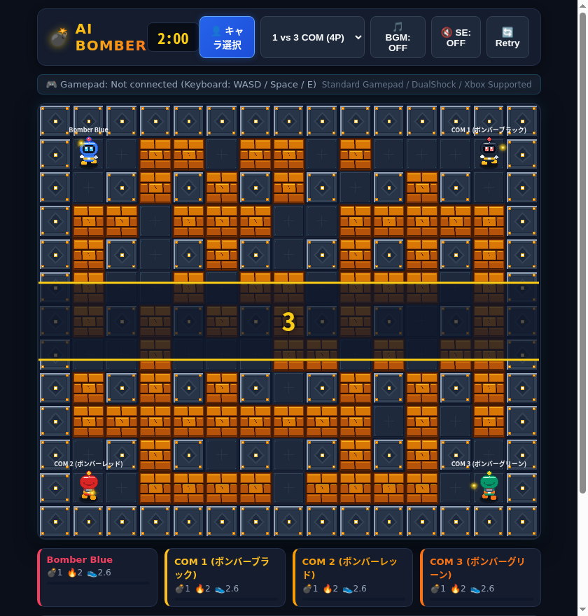

# AI Bomber (AIボンバーマン) 💣🔥

ブラウザで快適に動く、レトロアーケードスタイルのボンバーマンライク対戦ゲームです。
スマートなCOM AIとの対戦、HTML5 Gamepad APIによる本格的なコントローラー操作（バイブレーション対応）、Web Audio APIによるレトロサウンドを完備しています。



## ✨ 特徴 (Features)

- **最大4人対戦（1人 vs COM 1〜3体）**:
  - COMの人数はリアルタイムに1人〜3人まで変更可能（1vs1、1vs2、1vs3の4人バトルロイヤル）。
  - **賢いCOM AI**:
    - 危険度マップによる爆風回避（最優先避難）
    - 自爆防止シミュレーション（袋小路に自分を閉じ込めるボムは置かない）
    - アイテム収集、ブロック破壊、敵プレイヤー追跡
    - 個性（好戦派・コレクター・慎重派など）
- **本格ゲームパッド対応 (Gamepad API)**:
  - Xboxコントローラー、PlayStation DualShock/DualSense、Nintendo Switch ProコンなどのStandard Gamepadに完全対応。
  - 十字キー（D-Pad）＆左アナログスティックでのなめらかな移動。
  - A / B / X / RB / RT ボタンでのボム設置。
  - **ハプティクス（振動機能）**: 爆発時や被弾時にデュアルランブル振動が作動！
  - 接続状態やコントローラー名をHUDに自動表示。
- **ボンバーマン伝統のスムーズな操作性**:
  - **コーナリング・アシスト（Wall Sliding）**: 角に少し引っかかっても、通路の中央へ自動で回り込んで曲がれる快適な操作感。
  - ボム設置直後のすり抜け許可＆脱出後の障害物化。
  - **ボムキック (Bomb Kick)**: キックアイテム取得で、体当たりしたボムを前方に滑らせて攻撃可能！
  - **誘爆（連鎖爆発）**: 爆風が他のボムに届くと即座に大連鎖爆発！
- **アイテムシステム**:
  - 💣 **ボムアップ**: 最大設置ボム数 +1
  - 🔥 **ファイヤーアップ**: 爆炎の射程 +1
  - 👟 **スピードアップ**: 移動速度上昇
  - 🥊 **キック**: ボムを蹴って滑らせる
  - 🛡️ **シールド**: 爆風を1度だけ無効化
- **Web Audio API によるプロシージャルサウンド**:
  - 外部音声ファイルへの依存ゼロ。ボム設置音、大爆発音、アイテム取得音、キック音、被弾音、勝利ジングル、チップチューン風BGMをすべてブラウザのシンセサイザーで合成。

---

## 🎮 操作方法 (Controls)

### ゲームパッド (Gamepad)
| 操作 | ボタン |
| :--- | :--- |
| **移動** | 十字キー (D-Pad) または 左アナログスティック |
| **ボム設置** | `A` / `B` / `X` / `RB` / `RT` ボタン |
| **ポーズ** | `Start` / `Options` ボタン |
| **リトライ** | `Select` / `Back` ボタン |
| **振動** | 爆発・被弾時に自動振動 |

### キーボード (Keyboard)
| 操作 | キー |
| :--- | :--- |
| **移動** | `W` `A` `S` `D` または `矢印キー (↑ ↓ ← →)` |
| **ボム設置** | `Space` / `Enter` / `Z` / `J` |
| **ポーズ** | `P` / `Esc` |
| **リトライ** | `R` |

### スマートフォン / タッチ
画面下にオンスクリーンD-Padおよびボムボタンが表示されます。

---

## 🛠️ 開発・起動方法 (Development)

### 依存関係のインストール
```bash
npm install
```

### 開発用サーバー起動
```bash
npm run dev
```

### プロダクションビルド
```bash
npm run build
```
`dist/` フォルダに最適化された静的ファイルが出力されます。GitHub Pagesや静的ホスティングにそのままデプロイ可能です。

---

## 📁 ディレクトリ構成 (Project Structure)

```
ai-bomberman/
├── index.html        # メインHTML
├── package.json      # プロジェクト設定
├── src/
│   ├── main.ts       # アプリケーション初期化・UI連携
│   ├── game.ts       # ゲームメインループ・状態管理
│   ├── renderer.ts   # Canvas 2D レンダリング
│   ├── map.ts        # グリッド・マップ・アイテム管理
│   ├── bomb.ts       # ボム・爆風・キック・誘爆管理
│   ├── player.ts     # プレイヤー物理・当たり判定・コーナリング
│   ├── ai.ts         # COM AI（危険度マップ・BFS探索・自爆防止）
│   ├── input.ts      # Gamepad API & キーボード入力・振動
│   ├── audio.ts      # Web Audio API シンセ音源・BGM
│   ├── particles.ts  # パーティクル演出・画面シェイク
│   ├── constants.ts  # 定数・設定
│   └── style.css     # アーケード風UIスタイル
```

## 📜 ライセンス (License)
MIT License
